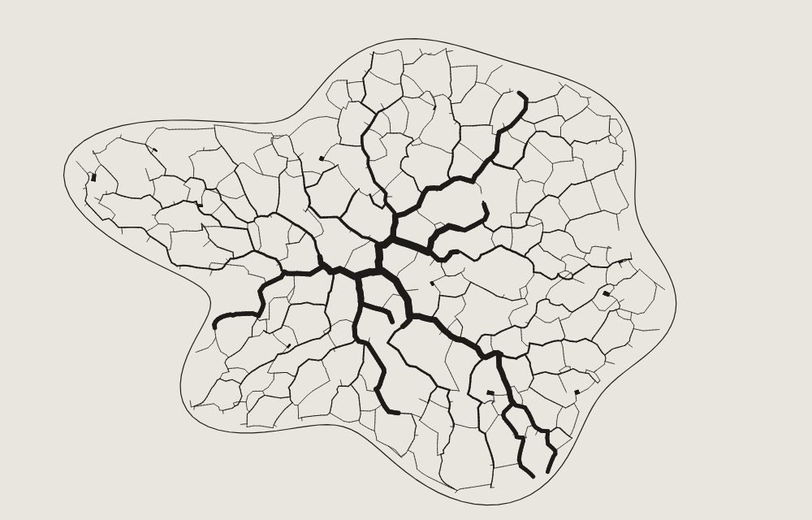

# venation

A parametric venation generator: leaf veins and dragonfly wing cells, drawn in the browser, exported as vectors and a flat graph, and carried onto printed lamps, a printed dragonfly and landform studies.

VS02-10, closed venation on a blob outline, seed 07.

## Run it

Open `src/index.html` in a browser, or the hosted page. It is one self-contained page plus `wing_geom.js`. It loads d3-delaunay and jsPDF from jsdelivr and IBM Plex from Google Fonts. Three tabs: Lab (the generator), Studies (the study sheets as tile galleries), Lamps (the first six lamp forms with their parameter files).

## What the Lab does

- Modes: open venation (a tree), closed venation (loops), wing cells (relaxed Voronoi), hybrid (veins and cells).
- Outlines: ovate and lanceolate leaf, Clubtail forewing and hindwing, disk, irregular blob.
- Wings: named veins from a Skillet Clubtail model, as the full set of 13 longitudinals or a fabrication set of 9. Each named vein is a trunk with a rank width; veins grown off it add width by Murray's rule, w^n = sum of w_i^n. No vein stops in the field: a free end is joined, extended to the next vein or the outline, or pruned if shorter than 3 steps.
- Load study: every 2D study on sheets VS02 and VS03 loads with its stored parameters, from the select or by a click on its tile in the Studies tab.
- Export: SVG with layers (`outline`, `veins`, `ridges`, `channels`, `cells`, `pterostigma`), `graph.json` (nodes, edges, cells, units mm, the parameter block), PNG at 2x and 4x, vector PDF.
- Note and Copy for chat: copies the study ID, the parameters changed against the stored ones, and the note, as one short block of text.

## IDs

A study sheet is `VSnn`; a tile is `VSnn-tt`. A made piece has an artifact ID, `<family>--<pattern>-<source study>__<nn>`, for example `vena-lamp-egg--cells-VS04-12__02`. Seed, base, height and version follow in the file name: `<ID>_s23_b2.00in_h190mm_v01.stl`.

| sheet | what it holds |
|---|---|
| VS02 | 16 studies: wing presets, closed leaf, blob and disk in each mode |
| VS03 | the wing venation pass, growth bias, the no-dead-end rule |
| VS04 | lamps v01: 6 forms at 2 seeds, perforated shells |
| VS05 | dragonfly v01, 2 variants |
| VS06a | 12 lamp patterns: thin windows in place of holes, and two open graded pieces |
| VS06b | 11 lamp wraps: wings and leaves wrapped around the form at 1, 3, 6 and 8 panels |
| VS06c | lamp iterations: oblique rims, windows below and open cells above, a wide cylinder |
| VS07 | dragonfly v02: window wings, faceted eyes, a body that prints without supports |
| VS08 | 16 landform studies: 4 venation patterns by 4 typologies |

## Folders

| folder | contents |
|---|---|
| `src/` | the live page and its images |
| `vena-studies/` | the pattern lab: page versions v01 to v04, sheet scripts, specs, every study sheet with its check file, the VS02-10 vector export |
| `vena-lamp/` | lamp builders v01 to v03, specs, patterns, plate 3MF files, bed overlays, renders, check files, slice notes |
| `vena-dfly/` | dragonfly builders v01 and v02, wing patterns, source body, print files, renders; `mech/` is the flapping model, not started |
| `vena-land/` | landform builder, patterns, heightfields, contours, four print tiles |
| `docs/` | the decision log |

The scripts are kept as they ran. They expect the working layout they were written in (`00_src`, `00_print`, `00_contacts`, `00_mockups`), not this one; read them as the record of the method.

## Printing

The print files are prepared for a Bambu P2S in PLA with a 0.4 mm nozzle, a 203 x 203 mm safe footprint and no supports. Nothing has been sliced or printed: grams and hours are estimates from the mesh, and PASS means the mesh checks passed. Each print folder has a README with dimensions, the print order, the checks that were run and what they do not cover. Most lamp pieces are fine work, under a 2 mm wall on purpose; print the window test piece first. Lamp STL files are not in the repo (they are large); the plate 3MF files carry the same meshes.

## References

1. Runions, A., Fuhrer, M., Lane, B., Federl, P., Rolland-Lagan, A.-G., Prusinkiewicz, P. Modeling and visualization of leaf venation patterns. ACM Transactions on Graphics 24(3), 2005. https://doi.org/10.1145/1073204.1073251 (linked, not included).
2. Needham, J. G. A genealogic study of dragon-fly wing venation. Proceedings of the United States National Museum 26, 1903, plates XXXI to LIV. Public domain; the plates are not included here.
3. Nervous System, Hyphae lamps, 2011: the same growth rule run on a 3D base volume and printed in nylon. The lamps here differ in construction: closed shells with ribs and thin windows, or perforated shells, made for filament printing without supports.

## Licence

Code under the MIT licence, see `LICENSE`.

## Tools

Rhino, Grasshopper, Blender, Python, Claude Code.
